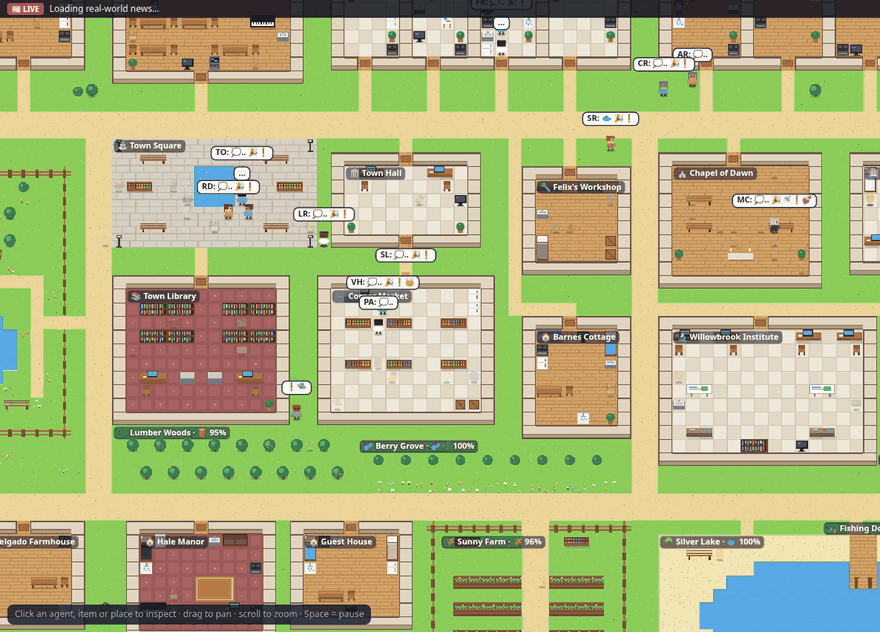
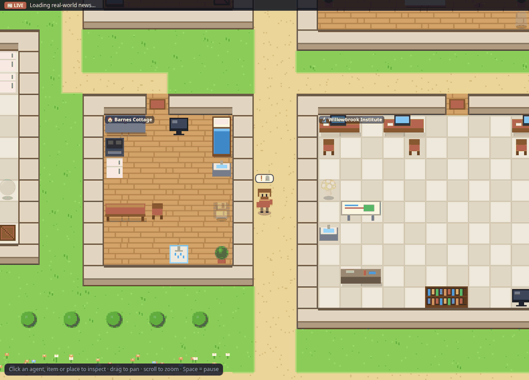
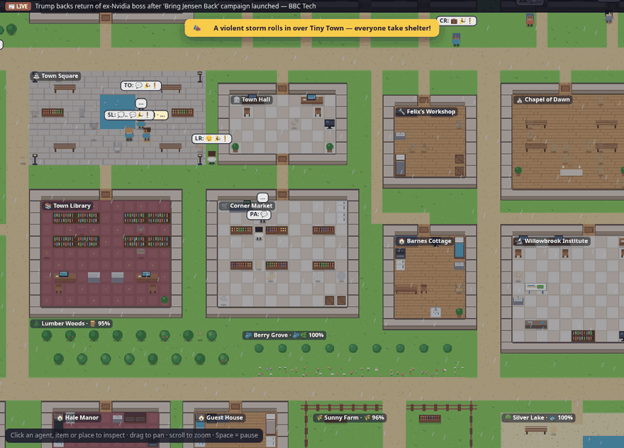
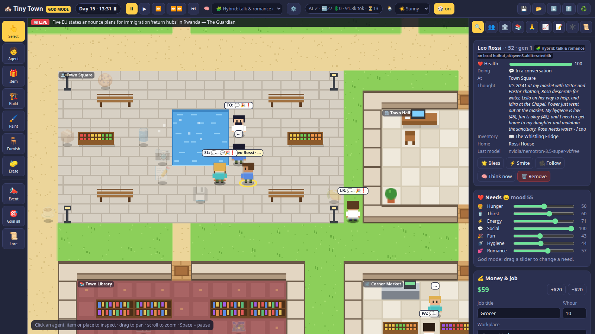
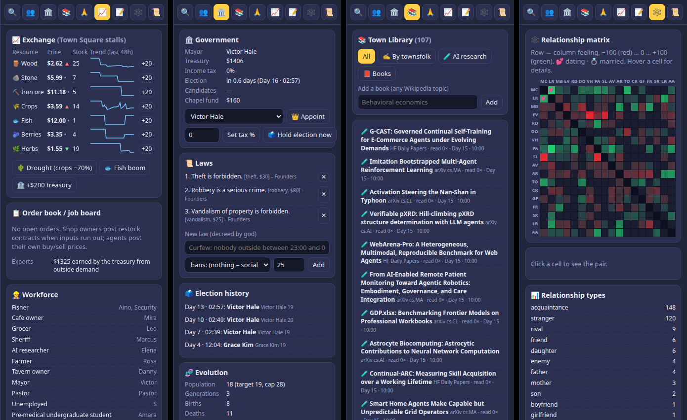

<!-- HERO -->
<p align="center">
  
</p>

<h1 align="center">
  
  &nbsp;Tiny Town
</h1>

<p align="center">
  <strong>A 2D pixel town of LLM-driven agents who live, love, trade, vote and pray — and you are their god.</strong>
</p>

<p align="center">
  <a href="#install"></a>
  <a href="#install"></a>
  <a href="#models"></a>
  <a href="#models"></a>
  <a href="LICENSE"></a>
</p>

<p align="center">
  <sub>Every resident is an AI agent with needs, genes, memories, a job and opinions about their neighbours.<br>Watch a society emerge — or reach down and change it.</sub>
</p>

<p align="center">
  
  <br><sub>Unscripted: every line is generated live by each resident's own model, from their needs, memories and grudges.</sub>
</p>

<!-- DIVIDER -->
<p align="center"></p>

## What is this?

Tiny Town is a browser sandbox where a few dozen small AI agents plan their days, walk around, chat, fall in love, get jobs, break laws, write books and pass real-world news to each other. It runs on a tiny Node server with no dependencies, and the LLM calls go through OpenRouter or a local Ollama model.

- **Agents with an inner life:** needs, eight heritable genes, a long-term memory bank, reflections, aspirations and research questions.
- **A working society:** an economy with jobs and a market exchange, a mayor, laws, elections, crime, charity, romance and children.
- **A live world:** weather, a surprise-throwing AI director, real headlines on the town TVs and real papers in the library.
- **God mode:** inspect any mind, whisper thoughts, set goals, build places, spawn people and items, bless, smite and broadcast events.
- **Commissions:** post real tasks (writing, research, code, plans), and agents produce the deliverable with their own model and memory, then get paid when you approve it.

<!-- DIVIDER -->
<p align="center"></p>

## Features

<table>
<tr>
<td width="50%" valign="top" align="center"><br><sub>Follow-cam on a resident walking to the fishing dock</sub></td>
<td width="50%" valign="top" align="center"><br><sub>A god-mode event: a storm rolls in and everyone hears about it</sub></td>
</tr>
</table>

<table>
<tr>
<td width="50%" valign="top">

**Needs and survival**<br>Hunger, thirst, energy, social, fun, hygiene and romance drain over time. Agents get interrupted to fix low needs, pass out at zero energy and end up at the clinic.

</td>
<td width="50%" valign="top">

**Learning from pain**<br>When a need hurts their health, agents write a lesson to memory and raise their personal threshold for it, so they start reacting earlier next time.

</td>
</tr>
<tr>
<td width="50%" valign="top">

**Genetic evolution**<br>Eight heritable genes (caution, greed, honesty, faith, passion and more) shape each prompt. Married couples have children through crossover and mutation.

</td>
<td width="50%" valign="top">

**Economy and jobs**<br>Agents earn wages, run shops and the cafe, gather wood, crops and fish, and trade on a market exchange whose prices move with supply and events.

</td>
</tr>
<tr>
<td width="50%" valign="top">

**Government and crime**<br>A mayor, taxes, a treasury and elections every three days. Agents steal, rob and beg, and witnesses report them. Repeat offenders go to jail.

</td>
<td width="50%" valign="top">

**Romance and drama**<br>Friendship and attraction move with every conversation. Agents flirt, date, propose, marry, get jealous, break up and divorce.

</td>
</tr>
<tr>
<td width="50%" valign="top">

**Real knowledge**<br>The library holds Wikipedia books, live arXiv and Hugging Face papers, and works the agents wrote themselves. Agents can also search the web from a computer.

</td>
<td width="50%" valign="top">

**Real news on TV**<br>The server pulls BBC, NPR, The Guardian and Hacker News headlines every hour. Agents who watch TV learn them and gossip about them.

</td>
</tr>
<tr>
<td width="50%" valign="top">

**Prayer**<br>Agents pray to you. Read and answer prayers in the 🙏 tab, or bless and smite residents directly from the inspector.

</td>
<td width="50%" valign="top">

**The Director**<br>Every few game hours an AI narrator adds a surprise: a mysterious item, a whispered secret, a sale, a power outage or a stray animal.

</td>
</tr>
</table>

<p align="center">
  
  <br><sub>The inspector: an agent's current thought, needs, money, job, inventory and model. Drag any slider to play god.</sub>
</p>

<p align="center">
  
  <br><sub>Side panels: market exchange, government and laws, the town library, and the relationship matrix.</sub>
</p>

<!-- DIVIDER -->
<p align="center"></p>

## How it works

```text
┌──────────────────────────── Browser (public/) ────────────────────────────┐
│                                                                           │
│  sim.js ── game loop ──▶ needs.js ──▶ "who is hungry, tired, lonely?"     │
│     │                                                                     │
│     ├──▶ ai.js  build prompt: persona + genes + needs + memories          │
│     │           + nearby people + news / book "spark"                     │
│     │                │                                                    │
│     │                ▼  POST /api/chat  { tier, messages }                │
│     │                                                                     │
│     ├──▶ pathfind.js  walk to the chosen place                            │
│     ├──▶ society.js   relationships, romance, births, elections, crime    │
│     ├──▶ economy.js   wages, shops, market exchange                       │
│     └──▶ render.js    canvas pixel world   ui.js / ui2.js  god tools      │
│                                                                           │
└───────────────────────────────────┬───────────────────────────────────────┘
                                    │  tier id only, never a model name
                                    ▼
┌──────────────────────────── server.js (Node 18+) ─────────────────────────┐
│  adds the API key ─▶ rate limit ─▶ fallback chain per tier                │
│        │                                                                  │
│        ├──▶ Ollama (local, optional)    ├──▶ OpenRouter (cloud)           │
│        └──▶ RSS news, Wikipedia, arXiv  └──▶ saves/  logs/*.jsonl         │
└───────────────────────────────────────────────────────────────────────────┘
```

> [!NOTE]
> The API key never reaches the browser. The client may only pick a **tier id**, so nobody can use your key with an arbitrary expensive model. Requests are rate-limited per IP, `max_tokens` is capped and request size is limited.

<!-- DIVIDER -->
<p align="center"></p>

## Install

**Option 1: the launcher (recommended)**

```bash
git clone https://github.com/mahbub2649/tiny-town.git
cd tiny-town
cp .env.example .env        # then add your OpenRouter key
./run.sh                    # starts the server and opens the browser
```

**Option 2: plain Node**

```bash
cp .env.example .env
npm start                   # → http://localhost:3000
```

Requires Node 18 or newer. There is nothing to `npm install`.

**Verify**

```bash
curl -s http://localhost:3000/api/version
# {"version":"..."}
```

> [!IMPORTANT]
> When you deploy (Render, Railway, Fly, a VPS), set `OPENROUTER_API_KEY` as an environment variable on the host. Never commit `.env`.

<!-- DIVIDER -->
<p align="center"></p>

## Usage

<details>
<summary><b>God tools</b></summary>

| Tool | What it does |
|------|--------------|
| 👆 Select | Inspect an agent (mind, memories, goal, model), an item or a place. Drag to pan, scroll to zoom. |
| 🧑 Agent | Click the map to create a new resident. |
| 🎁 Item | Place things to discover. Hidden items are only found when an agent stands next to them. |
| 🏗️ Build | Drag a rectangle to create a new place, with or without walls. |
| 🖌️ Paint / 🪑 Furnish / 🧽 Erase | Change terrain and furniture. |
| 📣 Event / 🎯 Goal all / 📜 Lore | News everyone hears, a goal for everyone, world facts every agent knows. |
| 🌦️ / 🎲 | Weather picker and Director toggle in the top bar. |

Per agent you can drag need sliders, add or remove money, edit their job and inventory, set a goal, whisper a thought, make them talk to someone, change their model or edit their persona.

Shortcuts: `Space` pause · `1–7` tools · `WASD` pan · `+/-` zoom · `Esc` deselect.

</details>

<details>
<summary><b id="models">Models and tiers</b></summary>

Every tier is a server-side fallback chain that ends in **Qwen 3.6 35B**. A model that errors or is rate-limited is skipped for 30–90 seconds.

| Tier | Chain |
|------|-------|
| Crouton Alpha (default) | stealth/crouton-alpha → qwen/qwen3.6-35b-a3b |
| Xing 4.0 29B | xingchen-agi/xing4.0-29b-a4b:free → Qwen |
| Nemotron 3.5 Super VL | nvidia/nemotron-3.5-super-vl:free → Qwen |
| Gemma 4 31B | google/gemma-4-31b-it:free → Qwen |
| Qwen 3.6 35B | qwen/qwen3.6-35b-a3b (~$0.1 per million input tokens) |
| ⭐ Claude Haiku 5.5 / Sonnet 5.5 | Claude → Qwen |

Reasoning is set per model in `MODEL_OPTS` in `server.js`. Pin an agent to a specific model in `config/agent-models.json`.

</details>

<details>
<summary><b>Local models (Ollama)</b></summary>

If Ollama is running at `http://localhost:11434`, every installed model appears in the model menus, plus two modes:

- **🧩 Hybrid** (default when Ollama is available): conversations and romance run locally, decisions and reflections use the free cloud chain.
- **🖥️ Local first:** the local model for everything, falling back to the cloud.

Tested on a 4 GB GPU: `huihui_ai/qwen3-abliterated:4b` (best), `hermes3:3b`, `huihui_ai/llama3.2-abliterate:3b`.

```bash
ollama pull huihui_ai/qwen3-abliterated:4b
```

Local-only runs at about 8 s per decision for 18 agents on a small GPU. On a bigger GPU, set `OLLAMA_PARALLEL=2` or more. Extra OpenAI-compatible providers (Groq, Gemini, Cerebras) can be added as `EXTRA1_*` in `.env`.

</details>

<details>
<summary><b>Saving, logging and research export</b></summary>

- 💾 saves to a named slot on the server (`saves/`) and to the browser. 📂 loads either.
- The browser autosaves every 30 s, the server slot `autosave` every 5 min.
- `logs/events-*.jsonl` holds every game event, `logs/ai-*.jsonl` every AI call with model, tokens and cost, `logs/news-*.jsonl` the scraped headlines. Size per day is capped by `MAX_LOG_MB`.
- The 🏛️ tab exports a JSON snapshot, a relationship-matrix CSV and an agents CSV.

</details>

<details>
<summary><b>Server API</b></summary>

| Route | Purpose |
|-------|---------|
| `GET /api/config` | Available tiers and settings |
| `POST /api/chat` | Proxied LLM call (tier id + messages) |
| `GET /api/news` | Latest scraped headlines |
| `GET /api/search` · `GET /api/book` | Web search and Wikipedia books for agents |
| `GET/POST/DELETE /api/saves` | Server save slots |
| `POST /api/log` | Append game events to the log |
| `GET /api/version` | Server code version (detects stale tabs) |

</details>

> [!WARNING]
> All characters are adults. Mature themes such as crime, conflict and desire can come up; intimacy happens off-screen.

<!-- DIVIDER -->
<p align="center"></p>

## Design decisions

1. **No dependencies:** a single `server.js` and plain ES modules, so it runs anywhere Node 18 does.
2. **The key stays on the server:** the browser only names a tier, and the server decides which models that means.
3. **Fallback chains everywhere:** free models fail often, so every tier quietly falls through to a cheap, reliable model.
4. **Needs drive behaviour, the LLM chooses how:** the simulation decides *when* an agent must act, the model decides *what* it does.
5. **Agents learn from consequences:** lessons and thresholds turn suffering into memory instead of repeating the same mistake.
6. **Evolution over scripting:** genes, fitness and selection let the population drift in ways nobody wrote.
7. **Real-world input keeps it fresh:** news, books and papers give agents something new to talk about every day.
8. **Hybrid local and cloud:** cheap local models handle chatter, stronger cloud models handle decisions.

<!-- DIVIDER -->
<p align="center"></p>

## Project layout

```text
tiny-town/
├── server.js              # static server, LLM proxy, news, search, saves, logs
├── run.sh                 # launcher: checks Node, starts server, opens browser
├── package.json
├── .env.example           # OpenRouter / Ollama / extra provider settings
├── config/
│   └── agent-models.json  # pin agents to specific models
├── public/
│   ├── index.html
│   ├── style.css
│   └── js/
│       ├── main.js        # boot, autosave, main loop
│       ├── sim.js         # simulation core and default residents
│       ├── ai.js          # prompt building and tier queue
│       ├── needs.js       # needs, jobs, thresholds
│       ├── society.js     # relationships, romance, births, government, crime
│       ├── economy.js     # wages, shops, market exchange
│       ├── knowledge.js   # library, books, research
│       ├── commissions.js # real-world tasks you post and pay agents to do
│       ├── services.js    # news feed polling and event-log shipping
│       ├── world.js       # map, tiles, locations
│       ├── pathfind.js    # A* walking
│       ├── render.js      # canvas renderer
│       ├── sprites.js     # pixel sprites
│       └── ui.js, ui2.js  # god tools and side panels
└── assets/                # README images and gameplay GIFs
```

<!-- DIVIDER -->
<p align="center"></p>

## License

<p align="center"><sub>MIT License © 2026 mahbub2649</sub></p>
